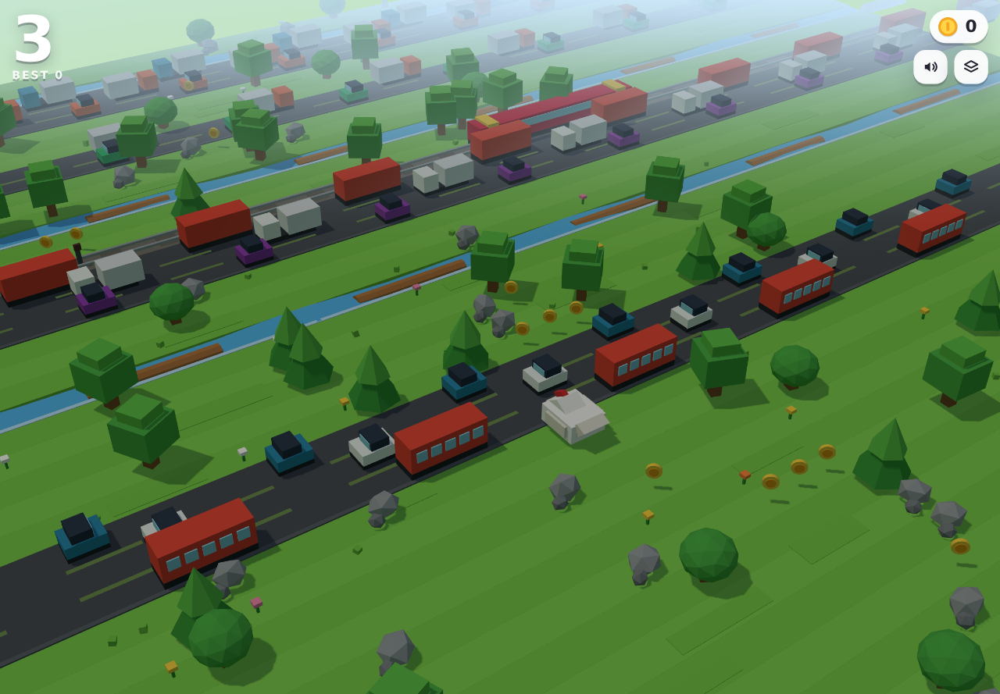

<p align="center">
  
</p>

<h1 align="center">Crossy Road — Voxel Clone</h1>

<p align="center">
  <a href="https://gerrcass.github.io/crossy-road-clone/"><b>▶ Play in your browser</b></a>
  &nbsp;·&nbsp; no install, no build step
</p>

<p align="center">
  <a href="https://gerrcass.github.io/crossy-road-clone/">
    
  </a>
</p>

A complete, playable Crossy Road clone in a single `index.html`: Three.js from a CDN
plus a few kilobytes of CSS, and nothing else — every prop, effect and sound is
generated in code (no models, textures or audio files).

**Live game:** <https://gerrcass.github.io/crossy-road-clone/>

## Controls

| Action | Keyboard | Touch |
| --- | --- | --- |
| Forward | `↑` / `W` / `Space` | tap, or swipe up |
| Left / right | `←` `→` / `A` `D` | swipe left / right |
| Back (limited) | `↓` / `S` | swipe down |
| Restart | `Space` / `Enter` / `R` | tap |
| Mute | `M` | speaker button |
| Camera style | `C` | cube button |

## Rules

- **Score** is the furthest row you reach. Coins are counted separately and saved with your best.
- **Traffic** flattens you — cars, trucks, buses and trains. Trees and rocks block your path instead.
- **Water** drowns you. Ride the logs, or hop across the lily pads.
  Ride a log too far towards the edge and you get **swept away**.
- **Crossing lights** flash and a bell rings before a train arrives.
- Wander more than 7 rows behind your best and a **hawk** carries you off.
- The camera has two styles (perspective and orthographic); the choice is cosmetic.

## How it's built

Everything lives in `index.html`: inline CSS for the HUD and overlays, and one commented
script split into sections — CDN bootstrap, a shared geometry/material library, prop
factories, chunk-based procedural generation, the player controller, death sequences,
particles/audio, and the game loop.

- **Terrain** is generated in *chunks* — a run of grass, 2–4 road lanes, 1–3 water rows,
  or a rail crossing — streamed in 34 rows ahead and deleted 18 behind. Chunk sequencing
  guarantees a safe strip between highways and after tracks.
- **Traffic** is a rigid, evenly spaced convoy on a looping coordinate, so lane timing is
  deterministic and every gap is survivable. Speeds and gaps ramp with distance.
- **Water** reuses that loop for logs; stacked lily-pad rows share their column layout, so
  you can never be stranded in front of an unreachable row.
- **Movement** is grid-snapped 135 ms hops with a parabolic arc, squash & stretch, a yaw
  turn towards travel, and a two-move input buffer.
- **The camera** follows forward progress with a little lateral parallax, and adapts to the
  viewport: phones pull it back, steepen it and widen the lens, while the fog distance is
  derived from the rig so the play area never turns to haze.
- **Performance**: ~25k triangles and roughly 1.1k draw calls with everything on screen,
  thanks to shared materials, merged dash/sleeper strips and per-object frustum culling.
- **Audio** is entirely synthesised with WebAudio (oscillators and filtered noise).

## Run locally

The live site is served by GitHub Pages. To run your own copy:

```bash
git clone https://github.com/gerrcass/crossy-road-clone.git
cd crossy-road-clone
npx serve .            # or: python3 -m http.server 5173
```

Opening `index.html` straight from disk also works in most browsers: if ES-module imports
are blocked on `file://`, the page falls back to a classic Three.js build. It needs an
internet connection the first time to fetch Three.js from the CDN.

## Credits

Built in [T3 Code](https://t3.codes). Inspired by [Crossy Road](https://crossyroad.com)
by Hipster Whale — this is an independent clone for learning purposes, not affiliated
with them.
